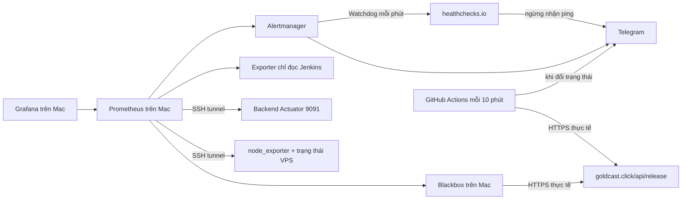

# Hướng dẫn GoldCast

Một tài liệu duy nhất cho mọi việc: chạy ứng dụng trên máy, dựng CI/CD, đưa
lên VPS, vận hành, giám sát và khôi phục khi mất máy chủ.

Mỗi bước kết thúc bằng một **Kiểm**. Đừng đi tiếp khi phép kiểm chưa đạt.
Phần lớn lỗi khó tìm nhất trong hệ thống này có cùng một dạng: lệnh chạy xong,
không báo lỗi, nhưng không làm gì cả. Vì vậy phép kiểm luôn nhìn vào *kết quả*,
không nhìn vào mã thoát của lệnh.

**Mục lục**

1. [Chạy trên máy cá nhân](#1-chạy-trên-máy-cá-nhân)
2. [Dựng Jenkins và pipeline kiểm thử](#2-dựng-jenkins-và-pipeline-kiểm-thử)
3. [Dựng VPS và triển khai lần đầu](#3-dựng-vps-và-triển-khai-lần-đầu)
4. [Cho Jenkins tự deploy](#4-cho-jenkins-tự-deploy)
5. [Pipeline G1 → build → G2 → Deploy → G3](#5-pipeline-g1--build--g2--deploy--g3)
6. [Vận hành production](#6-vận-hành-production)
7. [Monitoring và cảnh báo Telegram](#7-monitoring-và-cảnh-báo-telegram)
8. [Giá vàng thế giới theo phút](#8-giá-vàng-thế-giới-theo-phút)
9. [Khôi phục khi mất VPS](#9-khôi-phục-khi-mất-vps)
10. [Sự cố thường gặp](#10-sự-cố-thường-gặp)
11. [Giới hạn đã biết](#11-giới-hạn-đã-biết)

## Giá trị dùng trong tài liệu

Các phần 3, 4 và 9 dùng năm biến shell. **Gán lại ở đầu mỗi phiên terminal
mới**, kể cả sau khi `ssh` sang máy chủ, vì biến shell không đi theo kết nối:

```bash
IP=103.175.248.236
TEN_MIEN=goldcast.click
TEN_GITHUB=duongtanminh1912
REPO=duongtanminh1912/goldcast
REGISTRY=ghcr.io/duongtanminh1912
```

Thay bằng giá trị của bạn. Khi đổi, sửa cả các chỗ cố định trong repo:

| Đổi gì | Sửa ở đâu |
|---|---|
| IP máy chủ | `VPS` trong `Jenkinsfile`; mặc định `--host`/`--ssh-host` của `scripts/backup.py`, `monitoring/configure.py`, `monitoring/create-forward-key.py` (hoặc truyền tham số khi chạy) |
| Registry / tài khoản GitHub | `REG` trong `Jenkinsfile`; hai repository cho phép trong `validate_manifest` của `scripts/release.sh` |
| Tên miền | `deploy/Caddyfile`; `public_base` trong `scripts/release.sh`; URL trong `scripts/backup-remote.sh`, `monitoring/prometheus/prometheus.yml`, `monitoring/vps/collect.py` |

---

## 1. Chạy trên máy cá nhân

### 1.1 Chuẩn bị

Cần Docker Desktop (hoặc Docker Engine) và Git. Không cần cài Java, Node hay
PostgreSQL vì mọi thứ chạy trong container.

```bash
git clone https://github.com/duongtanminh1912/goldcast.git
cd goldcast
cp .env.example .env
```

**Kiểm:** `docker version` phải có cả **Client và Server**. Chỉ có Client thì
Docker daemon chưa chạy.

### 1.2 Chạy toàn bộ ứng dụng

```bash
make up            # hoặc: docker compose up -d --build
docker compose ps
```

Lần đầu mất vài phút vì phải build cả backend lẫn frontend.

**Kiểm:** có ba service db, backend, frontend; backend và db ở trạng thái
`healthy`. Mở `http://localhost:3000` thấy giao diện có dữ liệu.

Cấu hình dev bật seed: chuỗi nào vẫn rỗng sau ingest sẽ được nạp dữ liệu mô
phỏng gắn nhãn `synthetic`. Tắt seed không xoá dữ liệu mô phỏng đã có.

### 1.3 Chạy test, và xem cổng G1 chặn

Có JDK 21 + Maven thì chạy `mvn -f backend/pom.xml test`. Không có thì chạy
trong container, từ thư mục gốc repo:

```bash
backend_test() {
  COPYFILE_DISABLE=1 tar --exclude=backend/target --exclude=frontend/node_modules --exclude=frontend/.next -cf - backend frontend |
    docker run --rm -i maven:3.9-eclipse-temurin-21 sh -ec '
      mkdir /src; cd /src; tar -xf -
      mvn -B -f backend/pom.xml "$@"
    ' sh "$@"
}
backend_test test
```

**Kiểm:** `BUILD SUCCESS`, không có failure.

Toàn bộ G1 (giống check `backend-test` trên GitHub Actions) còn gồm:

```bash
python3 -m unittest discover -s scripts/tests -v
sh monitoring/check.sh
(cd frontend && npm ci && npm run typecheck)
node --test scripts/tests/test_*.mjs
```

Trong test Java có `ApiContractTest`, cổng đối chiếu DTO Java với kiểu
TypeScript ở frontend. Thử phá nó để thấy nó thật sự chặn:

```bash
sed -i '' 's/  series:/  seriesX:/' frontend/src/lib/types.ts   # Linux: sed -i
backend_test test -Dtest=ApiContractTest
```

**Kiểm:** test đỏ, thông báo chỉ đúng tên trường bị lệch. Hoàn nguyên:

```bash
git restore frontend/src/lib/types.ts
```

Một cổng chưa từng được chứng minh là biết chặn thì chưa phải là cổng.

---

## 2. Dựng Jenkins và pipeline kiểm thử

### 2.1 Dựng Jenkins

```bash
# Lấy GID của socket bên trong Docker, dùng được cả Docker Desktop và Linux.
export DOCKER_GID=$(docker run --rm -v /var/run/docker.sock:/var/run/docker.sock docker:27-cli stat -c %g /var/run/docker.sock)
docker compose -f jenkins/compose.yml up -d --build
docker exec jenkins cat /var/jenkins_home/secrets/initialAdminPassword
```

Mở `http://localhost:8081`, nhập mật khẩu khởi tạo, chọn "Install suggested
plugins" và tạo tài khoản quản trị.

`jenkins/compose.yml` lưu Jenkins home trong volume và chỉ mở UI tại
`127.0.0.1:8081`. Nếu đã có Jenkins, dùng tiếp instance đó; đừng chạy thêm
container trùng tên/port hay thay volume đang chứa credentials. Ở terminal mới,
gán lại `DOCKER_GID` trước khi dùng file Compose này.

**Kiểm:** đăng nhập được vào trang chủ Jenkins.

### 2.2 Job `goldcast-ci` trên nhánh kiểm thử

Chuẩn bị:

- Nếu fork repo, sửa `REG` trong `Jenkinsfile` thành namespace GHCR của bạn và
  commit trước khi build.
- Manage Jenkins → Credentials → System → Global, thêm **Username with
  password**, ID `ghcr`: tên GitHub và token có quyền `write:packages`.
- Tạo một nhánh khác `main` trên remote (ví dụ `ci/pre-deploy-gate`) để chạy
  thử mà không deploy.

New Item → `goldcast-ci` → **Pipeline**. Chọn **Pipeline script from SCM**,
SCM **Git**, URL repo của bạn, **Branches to build** là nhánh kiểm thử, Script
Path `Jenkinsfile`. Trong Build Triggers, tick **Poll SCM** và điền
`H/5 * * * *`. Bấm **Build Now**.

**Kiểm:** G1, Registry login, Build images once và G2 đều đạt; **Production
`SKIPPED`**. Có artifact `release.env` chứa `RELEASE_ID` và hai digest.

---

## 3. Dựng VPS và triển khai lần đầu

### 3.1 Thuê máy chủ

Yêu cầu bắt buộc:

- **Ảo hoá KVM**, không phải OpenVZ (Docker cần KVM)
- **IPv4 public riêng**, không phải NAT dùng chung
- **Ubuntu 24.04 LTS**, chọn đúng image `ubuntu-24.04-x86_64`. Không lấy bản
  `desktop` (tốn RAM) hay bản cài sẵn phần mềm (`-n8n`, `-ezyplatform`...) vì
  chúng thường đã chiếm cổng 80/443.

Cấu hình đã chạy được: 1 vCPU, 2 GB RAM, 20 GB đĩa. Đặt mật khẩu root và lưu ra
ngoài trình duyệt ngay; mất nó là mất đường vào khi chưa có khoá SSH.

### 3.2 Trỏ tên miền

Làm ngay khi có IP, vì DNS cần thời gian lan truyền. Sửa (không thêm) hai bản
ghi A:

| Loại | Tên | Giá trị | TTL |
|---|---|---|---|
| A | `@` | IP máy chủ | 300 |
| A | `www` | IP máy chủ | 300 |

Sót bản ghi A cũ thì tên miền lúc vào được lúc không, và Caddy có thể xin
chứng chỉ thất bại.

### 3.3 Đẩy khoá SSH

Nếu IP từng dùng trước đây, xoá dấu vân tay cũ; tạo khoá chỉ khi chưa có:

```bash
ssh-keygen -R $IP
ls -l ~/.ssh/id_ed25519 || ssh-keygen -t ed25519 -C "goldcast" -f ~/.ssh/id_ed25519
ssh-copy-id -i ~/.ssh/id_ed25519.pub root@$IP
```

`-i` là bắt buộc. Thiếu nó, `ssh-copy-id` đẩy **mọi** khoá công khai trong
`~/.ssh` lên root, gồm cả khoá dành riêng cho Jenkins.

**Kiểm:**

```bash
ssh -o PasswordAuthentication=no root@$IP 'hostname; grep PRETTY_NAME /etc/os-release'
```

Vào được mà không hỏi mật khẩu, và thấy `Ubuntu 24.04`. Chưa đạt thì đừng đi
tiếp: bước 3.6 sẽ tắt đăng nhập bằng mật khẩu.

### 3.4 Chạy kịch bản dựng máy

```bash
ssh root@$IP "apt-get update -qq && apt-get install -y -qq git && \
  git clone https://github.com/$REPO.git /root/goldcast && ls /root/goldcast/deploy"
ssh root@$IP 'bash /root/goldcast/deploy/dung-may-chu.sh 2>&1 | tee /root/dung-may-chu.log'
```

Đọc `deploy/dung-may-chu.sh` trước khi chạy. Script làm sáu việc: đặt múi giờ,
tạo swap 2 GB, cài Docker, tạo user `deploy`, mở ufw cho 22/80/443, rồi in lại
kết quả. Nó idempotent: rớt mạng giữa chừng thì chạy lại y nguyên.

Muốn chạy ngay trên máy chủ thì dùng `tmux`. Đừng cuộn chuột trong tmux khi
script đang chạy: tmux nhảy vào chế độ xem lịch sử, màn hình đứng yên và rất
dễ tưởng máy treo. Bấm `q` để thoát.

**Kiểm:** sáu dòng cuối cho thấy Docker và Compose có phiên bản, swap `2.0Gi`,
user `deploy` thuộc nhóm `docker`, ufw active và chỉ mở 22/80/443.

### 3.5 Cấp sudo cho `deploy`

```bash
ssh root@$IP "usermod -aG sudo deploy && \
  echo 'deploy ALL=(ALL) NOPASSWD:ALL' > /etc/sudoers.d/deploy && \
  chmod 440 /etc/sudoers.d/deploy && visudo -c"
ssh deploy@$IP 'sudo -n id && echo SUDO_OK'
```

**Kiểm:** ra `uid=0(root)` kèm `SUDO_OK`. **Chưa ra thì tuyệt đối không đi
tiếp**: bước sau tắt đăng nhập root, và nếu `deploy` chưa vào được thì không còn
đường nào vào máy.

### 3.6 Siết SSH — bước nguy hiểm nhất

Cần **hai cửa sổ**. Cửa sổ A giữ một phiên root đang mở làm đường lui:

```bash
ssh root@$IP
TOI_DA_KIEM_KHOA=yes bash /root/goldcast/deploy/siet-ssh.sh
```

Script tắt đăng nhập root và mật khẩu, rồi hỏi lại tiến trình `sshd` đang chạy.
Phải thấy **bốn dòng `ok`**.

Cửa sổ B, trên máy cá nhân:

```bash
ssh deploy@$IP 'echo VAO_DUOC'
```

Ra `VAO_DUOC` thì mới đóng cửa sổ A. Không ra thì hoàn tác trong cửa sổ A:

```bash
rm /etc/ssh/sshd_config.d/01-goldcast.conf && systemctl reload ssh
```

Mất cả hai cửa sổ vẫn còn đường: bảng điều khiển nhà cung cấp luôn có console
VNC vào thẳng máy.

### 3.7 Chỗ cho ứng dụng và `.env` production

Từ đây root không SSH vào được nữa; mọi thứ đi qua `deploy` và `sudo`. Clone
bằng `deploy` để không sinh file thuộc root trong thư mục `deploy` phải ghi:

```bash
ssh deploy@$IP "sudo mkdir -p /opt/goldcast && sudo chown deploy:deploy /opt/goldcast && \
  git clone https://github.com/$REPO.git /opt/goldcast"
```

Sinh bí mật thẳng trên máy chủ, không qua màn hình hay lịch sử shell:

```bash
ssh deploy@$IP "umask 077; cd /opt/goldcast && \
  printf 'POSTGRES_DB=goldcast\nPOSTGRES_USER=goldcast\nPOSTGRES_PASSWORD=%s\nAPP_ADMIN_TOKEN=%s\nAPP_CORS_ALLOWED_ORIGINS=https://$TEN_MIEN\nAPP_INGEST_ENABLED=true\nAPP_INGEST_SEED_ON_EMPTY=false\n' \
  \"\$(openssl rand -hex 24)\" \"\$(openssl rand -hex 32)\" > .env && \
  chmod 600 .env && ls -l .env && grep -c . .env"
```

**Kiểm:** ra `-rw-------` và số `7`. Đừng `cat` file đó.

Muốn dựng bản demo có dữ liệu ngay khi nguồn ngoài không truy cập được, đổi
`APP_INGEST_SEED_ON_EMPTY=true` trước khi chạy stack; giao diện sẽ gắn nhãn mô
phỏng. Không ghi đè `.env` khi đang dùng một DB volume đã có dữ liệu.

### 3.8 Chuyển release đã qua G2 lên VPS

Không build lại bằng tay cho production. Chọn một build Jenkins có G1/G2 thành
công, tải artifact `release.env` về thư mục gốc repo local (Git bỏ qua file
này) và ghi lại **commit đầy đủ của đúng build đó**:

```bash
RELEASE_COMMIT='SHA_CUA_BUILD_DA_QUA_G2'
RELEASE_DIR="/opt/goldcast/releases/initial-$RELEASE_COMMIT"
grep -Ec '^(BACKEND|FRONTEND)_IMAGE=[^[:space:]]+@sha256:[a-f0-9]{64}$' release.env
grep '^RELEASE_ID=' release.env
ssh deploy@$IP "mkdir -p '$RELEASE_DIR'"
git archive "$RELEASE_COMMIT" docker-compose.prod.yml deploy/Caddyfile scripts/release.sh scripts/check-pages.mjs |
  ssh deploy@$IP "tar -xf - -C '$RELEASE_DIR'"
scp release.env "deploy@$IP:$RELEASE_DIR/release.env"
```

**Kiểm:** phép đếm ra `2` (hai image dùng `@sha256:`, không phải tag) và có
`RELEASE_ID`. VPS phải kéo được package GHCR: đặt package Public, hoặc đăng
nhập registry trên VPS bằng token chỉ đọc. Không thay digest bằng `latest` khi
kéo lỗi.

### 3.9 Chạy đúng digest và ghi baseline

Chờ DNS trước để tránh lỗi cấp chứng chỉ:

```bash
dig +short $TEN_MIEN
dig +short www.$TEN_MIEN
```

Cả hai phải ra đúng IP máy chủ. Rồi chạy stack, vẫn giữ `RELEASE_DIR`:

```bash
ssh deploy@$IP "docker compose --env-file /opt/goldcast/.env --env-file '$RELEASE_DIR/release.env' -p goldcast -f '$RELEASE_DIR/docker-compose.prod.yml' up -d --wait --wait-timeout 300"
ssh deploy@$IP "docker compose --env-file /opt/goldcast/.env --env-file '$RELEASE_DIR/release.env' -p goldcast -f '$RELEASE_DIR/docker-compose.prod.yml' ps"
```

Project phải là `goldcast` để tạo đúng volume `goldcast_goldcast-pgdata`.

**Kiểm:** bốn container db, backend, frontend, caddy; db và backend healthy. Chỉ
`caddy` có `0.0.0.0:80` và `0.0.0.0:443`. Từ máy cá nhân:

```bash
curl -I https://$TEN_MIEN     # HTTP/2 200
curl -I http://$TEN_MIEN      # 308 sang https
for p in 22 80 443 3000 5432 8080; do
  nc -z -w 2 $IP "$p" >/dev/null 2>&1 && echo "$p MO" || echo "$p dong"
done
```

Chỉ 22, 80, 443 mở. Cổng Docker publish có thể đi vòng qua luật ufw, nên phải
quét từ bên ngoài, không tin `ufw status`.

Ghi baseline bằng chính script và manifest của release:

```bash
ssh deploy@$IP "sh '$RELEASE_DIR/scripts/release.sh' bootstrap '$RELEASE_DIR'"
ssh deploy@$IP 'cat /opt/goldcast/.last-good-release'
```

Bootstrap xác minh readiness, image ID, `RELEASE_ID` công khai qua
`/api/release` và các trang HTTPS rồi mới ghi con trỏ. Lỗi thì sửa nguyên nhân
và chạy lại; không tự tạo `.last-good-release`.

---

## 4. Cho Jenkins tự deploy

### 4.1 Khoá SSH riêng cho Jenkins

Không dùng khoá cá nhân. Jenkins chạy tự động nên khoá không có passphrase:

```bash
ssh-keygen -t ed25519 -f ~/.ssh/jenkins_deploy -N "" -C "jenkins"
ssh-copy-id -i ~/.ssh/jenkins_deploy.pub deploy@$IP
ssh -i ~/.ssh/jenkins_deploy -o IdentitiesOnly=yes deploy@$IP 'docker ps && echo OK'
```

**Kiểm:** ra `OK`. `IdentitiesOnly=yes` là mấu chốt; thiếu nó, SSH thử mọi
khoá trong `~/.ssh` và có thể vào bằng khoá cá nhân, nên phép kiểm báo đạt mà
không chứng minh gì.

### 4.2 Credentials và nhánh

Manage Jenkins → Credentials → System → Global:

| Kind | ID | Nội dung |
|---|---|---|
| SSH Username with private key | `vps-deploy` | username `deploy`, khoá `~/.ssh/jenkins_deploy` |
| Username with password | `ghcr` | tên GitHub, token `write:packages` |

Lấy khoá vào clipboard mà không in ra màn hình: `pbcopy < ~/.ssh/jenkins_deploy`
(macOS) hoặc `xclip -sel clip < ~/.ssh/jenkins_deploy` (Linux).

Khi đã có baseline và credential VPS, đổi **Branches to build** của
`goldcast-ci` sang `*/main`.

Nếu máy chủ từng được cài lại, container Jenkins vẫn nhớ host key cũ và Deploy
đỏ với `Host key verification failed`. `StrictHostKeyChecking=accept-new` chỉ tự
nhận host **mới tinh**; host đã biết mà đổi khoá thì vẫn bị chặn. Xoá bản ghi cũ
bằng đường dẫn tuyệt đối (vì `docker exec` không chắc đặt `HOME`), rồi kiểm
bằng chính file đó:

```bash
docker exec jenkins ssh-keygen -f /var/jenkins_home/.ssh/known_hosts -R "$IP"
docker exec jenkins ssh-keygen -F "$IP" -f /var/jenkins_home/.ssh/known_hosts
```

Không còn bản ghi thì lệnh `-F` không in gì và trả mã 1.

**Kiểm:** đưa một thay đổi vào `main` qua PR, **không bấm gì trong Jenkins**.
Trong 5 phút phải có build mới ghi "Started by an SCM change". G1, Build, G2,
Deploy và G3 đều đạt; Production không `SKIPPED`. Rồi:

```bash
ssh deploy@$IP 'cat /opt/goldcast/.last-good-release'
```

Đường dẫn chứa commit và số build vừa chạy; `release.env` trong đó khớp
artifact Jenkins.

---

## 5. Pipeline G1 → build → G2 → Deploy → G3

GitHub Actions chạy G1 trong required check `backend-test`. Jenkins chạy toàn
bộ luồng; nhánh khác `main` (hoặc PR) dừng sau G2.

- **G1:** test Java (gồm hợp đồng API và công thức quy đổi), TypeScript
  typecheck, bộ test release/rollback/backup bằng `python:3.13-alpine`, test
  probe/snapshot bằng Node 22, và `monitoring/check.sh` (promtool/amtool).
  Container test không được gắn Docker socket.
- **Build:** build/push một lần cho `linux/amd64`, tag `<commit>-<job>-<build>`,
  chốt `RELEASE_ID` và hai digest vào artifact `release.env`.
- **G2:** `scripts/g2.sh` dựng `docker-compose.ci.yml` trên Docker của Jenkins,
  project riêng cho mỗi build, DB riêng, không publish cổng, provider ngoài tắt
  và seed mô phỏng bật để kết quả lặp lại được. Hai ca:
  - *Cài mới:* Flyway khởi tạo, kiểm lịch sử migration, 39 bất biến API trong
    `scripts/smoke.mjs` (ví dụ `worldVndPerGram × troyOunceInGrams` phải bằng
    `usdPerOunce × vndPerUsd`), dự báo NAIVE và ba trang SSR qua Caddy.
  - *Nâng cấp:* tạo DB ở Flyway target V1, nạp `scripts/fixtures/upgrade-v1.sql`,
    rồi chạy cùng image ở target mới nhất; `assert-upgrade.sql` kiểm dữ liệu cũ
    còn nguyên, smoke và các trang phải đạt lại.

  Cả hai ca kiểm mô hình `ARX_MACRO` trên dữ liệu vĩ mô mô phỏng (FRED tắt trong
  G2, mục 6.6), kiểm feed giá phút bằng nguồn HTTP giả lập (mục 8) và đối chiếu
  `RELEASE_ID` frontend/backend qua `/api/release`. PostgreSQL/Caddy ghim digest
  như production. Container, mạng và dữ liệu tạm được dọn khi kết thúc.
- **Deploy** (chỉ `main`, không phải PR): Jenkins chuyển `release.env`, Compose,
  Caddyfile và script release qua SSH vào `/opt/goldcast/releases/<RELEASE_ID>/`
  rồi chạy `scripts/remote-release.sh deploy`. Không `git pull` mã trên VPS.
- **G3:** so image ID container với digest, kiểm readiness backend, HTTPS qua
  Caddy tới các trang có nội dung thật, và `/api/release` phải trả
  `releaseId`/`backendReleaseId` bằng `RELEASE_ID`. Đạt thì ghi nguyên tử
  `.last-good-release`.

### 5.1 Manifest được kiểm thế nào

Trước khi lấy khoá hoặc chạy Docker, `release.sh` kiểm `release.env` như dữ liệu,
không `source` như shell:

- `RELEASE_ID`, `BACKEND_IMAGE`, `FRONTEND_IMAGE` mỗi khoá xuất hiện đúng một
  lần; không nhận khoá khác. Mọi manifest đều phải có `RELEASE_ID`.
- Image phải thuộc đúng repository của từng service và có digest `sha256` gồm
  64 ký tự hex thường; không nhận tag, nội suy hay dấu nháy.

Baseline và mục tiêu rollback cũng được kiểm như vậy. Manifest lỗi bị từ chối
trước `pull`/`up` và không bao giờ được ghi thành bản tốt.

### 5.2 Rollback

Khi bắt đầu deploy, script lưu cố định bản tốt trước đó vào
`<release>/previous-good-release` và giữ `.env` thành `<release>/runtime.env`.
Nếu Deploy hoặc G3 lỗi, nhánh `post.unsuccessful` của Jenkins gọi rollback về
đúng bản đã lưu (không đọc lại `.last-good-release`), đợi sẵn sàng và xác minh
lại. Build vẫn đỏ sau rollback. Nếu rollback cũng lỗi, khoá được giữ để người
vận hành xử lý.

Rollback chỉ quay lui image và cấu hình, **không phục hồi DB**. Migration phải
tương thích với cả bản ứng dụng trước và sau.

Sau khi G3 đã ghi `.last-good-release`, lỗi dọn khoá chỉ phát cảnh báo. Nếu
Jenkins gọi rollback do mất phản hồi SSH sau thời điểm này, script nhận ra bản
đã được ghi nhận và bỏ qua.

### 5.3 Build bị ngắt: `status` và `recover`

Khoá `/opt/goldcast/.release-lock` ngăn deploy chồng nhau và tồn tại suốt
Deploy → G3. Mỗi release lưu `deploy-started-at`, `deploy-build-url`,
`deploy-phase` và `previous-good-release`. Trên VPS:

```bash
RELEASE_DIR='/opt/goldcast/releases/<commit>-<job>-<build>'
sh "$RELEASE_DIR/scripts/release.sh" status "$RELEASE_DIR"
```

Mở URL build, xác nhận build và lệnh SSH/deploy trên VPS đã dừng, rồi:

```bash
sh "$RELEASE_DIR/scripts/release.sh" recover "$RELEASE_DIR" --confirm-stopped
```

Bản đã được G3 ghi nhận thì recovery xác minh lại rồi dọn khoá dư; chưa ghi
nhận thì rollback về bản trước đã lưu. Khoá thuộc release khác, thiếu mục tiêu
rollback hoặc xác minh lỗi đều không được tự xoá. Không bao giờ phục hồi chỉ dựa
vào tuổi của khoá.

### 5.4 Chụp lại baseline

`scripts/bootstrap-release.sh` chụp digest, môi trường, lệnh, healthcheck,
volume và Caddyfile của container đang chạy, rồi xác minh như G3 trước khi ghi
con trỏ. Nó không restart production và chỉ nhận container có `RELEASE_ID`.

- Máy chủ chưa có `.last-good-release`: `sh scripts/bootstrap-release.sh`
- Thay baseline bằng snapshot của production đang khoẻ, không có deploy đang
  chạy: `sh scripts/bootstrap-release.sh --refresh`. Thất bại thì giữ bản tốt cũ.

Chạy tại `/opt/goldcast` sau khi cập nhật checkout. Snapshot và `runtime.env`
có thể chứa mật khẩu nên được ghi quyền 600. Pipeline từ chối deploy khi
baseline thiếu `runtime.env`.

Thao tác Compose thủ công trên production luôn dùng cấu hình của release:

```bash
docker compose --env-file <release>/runtime.env --env-file <release>/release.env \
  -p goldcast -f <release>/docker-compose.prod.yml ...
```

---

## 6. Vận hành production

Mọi thay đổi cấu hình chỉ có hiệu lực trên VPS sau khi đi qua pipeline `main`;
sửa file trong checkout không đổi release đang chạy.

### 6.1 Image hạ tầng và readiness

PostgreSQL và Caddy được ghim bằng digest trong cả Compose CI lẫn production.
Đổi chúng bằng PR, chạy lại G2 và kiểm tương thích DB trước khi deploy.

Frontend có healthcheck gọi `/api/release`, chỉ healthy khi định danh frontend
và backend khớp; Caddy đợi frontend healthy. Probe thử lại tối đa năm lần với
lỗi kết nối/502/503/504, mỗi request tối đa 15 giây. HTTP 200 nhưng sai định
danh hoặc trang hiển thị lỗi vẫn bị từ chối.

**Giới hạn RAM.** Mỗi container production có `mem_limit`: db 384 MB, backend 768 MB,
frontend 320 MB, Caddy 128 MB, tổng 1600 MB trên VPS 2 GB. Giới hạn này bắt buộc chứ
không chỉ để phòng xa: backend chạy `-XX:MaxRAMPercentage=75`, nên heap JVM tính theo
giới hạn của container; thiếu giới hạn thì JVM tính theo RAM cả máy và giành chỗ với
Postgres. G2 chạy db, backend và frontend dưới cùng giới hạn để lỗi thiếu RAM lộ ra
trước khi deploy. `scripts/tests/test_compose_limits.py` đỏ nếu một service production
thiếu giới hạn, tổng vượt 2048 − 400 MB, hoặc G2 lệch production. Đổi gói VPS thì đổi
`VPS_RAM_MB` trong test đó cùng lúc.

Frontend gọi backend với timeout mặc định 5 giây (`API_TIMEOUT_MS`), tính cả phần thân
phản hồi. Backend treo thì trang hiện thông báo lỗi chung chung thay vì chờ khoảng năm phút; URL nội bộ
chỉ ghi vào log của container frontend, không hiện cho người xem.

### 6.2 Độ mới dữ liệu và ingest

`MarketSummary.warnings` cảnh báo từng mã khi thiếu dữ liệu, ngày quan sát ở
tương lai, hoặc chậm hơn **hai ngày công bố** theo múi giờ `Asia/Ho_Chi_Minh`.
XAUUSD và tỷ giá bỏ thứ Bảy/Chủ nhật; vàng trong nước tính mọi ngày. Chưa có
lịch ngày lễ. Chuỗi trong nước có dữ liệu synthetic cũng bị cảnh báo.
`generatedAt` là thời điểm tạo response, không phải thời điểm cập nhật giá.
Độ mới không dùng làm readiness: nguồn ngoài ngừng cập nhật không làm ứng dụng
bị rollback.

`GET /api/v1/admin/ingest/status` (cần `X-Admin-Token`) trả lượt thử gần nhất,
trạng thái đang chạy/lỗi transaction, report đã commit gần nhất và lần thành
công của từng provider. Telemetry này reset khi backend restart. Gọi từ bên
trong backend qua Docker/SSH như `scripts/ingest.sh`; không mở endpoint admin
ra Internet.

Ingest thủ công: `make seed` (local) hoặc `scripts/ingest.sh`. Ingest thủ công
và scheduler dùng chung khoá; yêu cầu chạy chồng trả HTTP 409.

Mỗi lượt ingest gọi mọi provider trước, không giữ transaction hay connection nào,
rồi mới ghi trong một transaction ngắn. Các dòng đã lưu của mỗi chuỗi được đọc một
lần; quote trùng thì bỏ qua, quote bị sửa giá thì cập nhật đúng dòng đó. Đo trên
Postgres thật với 618 quote đã có: số lần quét bảng `price_point` giảm từ 620 còn 2.

### 6.3 Giới hạn thời gian và dọn release

- Pipeline giới hạn 45 phút, giữ 30 build và artifact của 20 build gần nhất.
- SSH kết nối tối đa 10 giây, ngắt sau ba lần không phản hồi (mỗi 15 giây).
- `remote-release.sh` dùng `flock` để lệnh trên VPS không đua với rollback khi
  mất SSH: chờ khoá tối đa 390 giây. Mỗi thao tác có ngân sách riêng, đủ chứa các
  bước bên trong nó: `deploy` 600 giây (pull + `up --wait-timeout 300`), `verify`
  240 giây, `rollback` 480 giây (`up --wait-timeout 300` + verify). Rollback bị
  `timeout` giết giữa chừng sẽ không ghi được `.last-good-release` và để lại khoá,
  nên ngân sách phải dư. Jenkins chờ rollback 16 phút, lâu hơn trường hợp chậm nhất
  (chờ khoá + ngân sách + thời gian kill). `scripts/tests/test_release_budgets.py`
  đọc các con số này từ `remote-release.sh`, `release.sh` và `Jenkinsfile`, rồi đỏ khi chúng không còn khớp.
- Log mỗi service production xoay vòng `3 × 10 MB`. Không chạy Docker prune
  toàn máy và không tự xoá image trên GHCR khi release/backup còn cần nó.

Dọn thư mục release cũ (cần Python ≥ 3.9 trên VPS):

```bash
RELEASE_DIR=$(cat /opt/goldcast/.last-good-release)
python3 "$RELEASE_DIR/scripts/retention.py" release /opt/goldcast --keep 14
```

Lệnh trên chỉ in kế hoạch; thêm `--apply` để thực hiện. Script chỉ xét release
`promoted`/`rolled-back` cũ ít nhất bảy ngày; luôn giữ last-good, mục tiêu
rollback của nó, release đang chạy, release chưa hoàn tất và 14 release gần
nhất. Có khoá deploy/backup thì từ chối. Không xoá volume hay image.

### 6.4 Backup ngoài VPS

`scripts/backup.py` chụp release, `runtime.env` và DB dưới khoá deploy, truyền
về máy khác, kiểm SHA-256 rồi **phục hồi thử** vào PostgreSQL tạm không mạng.
Không dừng ứng dụng hay ghi vào DB production.

```bash
python3 scripts/backup.py \
  --key "$HOME/.ssh/jenkins_deploy" \
  --destination "$HOME/goldcast-private-backups"
```

Thư mục đích nằm ngoài checkout, quyền 700 (chưa có thì script tự tạo). Backup
chứa bí mật: không đưa vào Git hay artifact công khai. Script cần release đã
promoted, `runtime.env`, Python ≥ 3.9, Docker và SSH.

Job định kỳ `goldcast-backup` dùng `jenkins/Jenkinsfile.backup`, credential
`vps-deploy`, SCM `main`. Lịch `H 2 * * *` chạy khoảng 02:00 theo múi giờ của
Jenkins. Chạy một lần thành công để đăng ký lịch, rồi kiểm `Build periodically`.
Dữ liệu nằm ở named volume `goldcast-private-backups` trên máy Jenkins; volume
này không bảo vệ khỏi mất máy Jenkins, nên chép định kỳ sang nơi lưu trữ riêng
tư khác.

Giữ 14 backup đã kiểm chứng. Trên VPS chỉ xoá bản remote đã có dấu xác nhận
truyền + restore, ngoài 14 bản mới nhất và cũ hơn bảy ngày. Backup dở dang được
giữ để điều tra, không tính thay bản tốt.

Nếu backup bị ngắt và để lại `.release-lock`, `status` cho thấy owner là thư mục
backup. Xác nhận job, SSH và `pg_dump` đều đã dừng trước khi dọn khoá; `recover`
không xử lý owner backup.

### 6.5 Diễn tập rollback

Job thủ công `goldcast-rollback-drill` (`jenkins/Jenkinsfile.rollback-drill`)
diễn tập trong mạng/DB riêng, không SSH vào VPS. Nhập `RELEASE_ID`,
`BACKEND_IMAGE`, `FRONTEND_IMAGE` từ **cùng một artifact đã qua G2**.

- `FAIL_AT=G3`: dựng baseline, deploy candidate có bộ digest khác, cố ý làm sai
  định danh frontend để G3 lỗi. Nhánh `post.unsuccessful` phải rollback và kiểm
  lại image, định danh, ba trang, 39 phép kiểm API, con trỏ và khoá.
- `FAIL_AT=G2`: định danh không hợp lệ, Jenkins phải dừng trước deploy.

Job cố ý kết thúc **FAILURE**. Chỉ kết luận diễn tập đạt khi artifact
`rollback-evidence.txt` của chính build đó có `PASS`. G2 lỗi thì không có PASS.

### 6.6 Dữ liệu vĩ mô cho mô hình ARX (FRED)

Mỗi lượt ingest, sau khi dữ liệu giá đã commit, backend tải hai chuỗi từ FRED vào bảng
`macro_observation`: lợi suất thực 10 năm Mỹ (`DFII10`, có thể âm) và chỉ số USD rộng của
Fed (`DTWEXBGS`). FRED được gọi trong transaction riêng, nên lỗi FRED không làm mất dữ liệu
giá. Kết quả hiện trong `GET /api/v1/admin/ingest/status` dưới provider `fred`.

- Tắt bằng `APP_MACRO_ENABLED=false`. G2 tắt FRED; khi seed bật và bảng rỗng, backend sinh
  dữ liệu vĩ mô mô phỏng gắn nguồn `synthetic`, và dự báo dùng nó sẽ cảnh báo rõ.
- `ARX_MACRO` chỉ được đề xuất cho XAU/USD khi giá trị vĩ mô mới nhất không cũ hơn
  `app.macro.max-lag-days` (mặc định 7 ngày) so với giá vàng gần nhất. Không đạt thì yêu cầu
  `model=ARX_MACRO` trả 422 `macro-unavailable` và AUTO bỏ qua mô hình này.
- Kiểm nhanh dữ liệu trên VPS:

```bash
docker exec goldcast-db psql -U goldcast -d goldcast -c \
  "SELECT series_code, max(observed_on), count(*), string_agg(DISTINCT source, ',') FROM macro_observation GROUP BY 1"
```

Migration V4 chỉ thêm bảng, nên rollback về bản trước vẫn chạy được (không có `ARX_MACRO`).

**Giám sát:** backend xuất `goldcast_macro_observation_lag_days{series}`, tính bằng số ngày
từ giá trị vĩ mô mới nhất tới phiên giá vàng gần nhất, đúng cách `ForecastService` quyết
định có xét `ARX_MACRO` hay không. Vượt `app.macro.max-lag-days` liên tục 1 giờ thì luật
`GoldcastMacroDataStale` báo Telegram. FRED mất hẳn trên 3 giờ thì `GoldcastProviderUnavailable`
báo với `provider="fred"`. Tắt `APP_MACRO_ENABLED` thì cả hai im.

---

## 7. Monitoring và cảnh báo Telegram

Monitoring chạy độc lập với pipeline. Máy Mac chạy Jenkins đặt Prometheus,
Grafana, Alertmanager và Blackbox; VPS chỉ chạy node_exporter và bộ thu trạng
thái mỗi phút.



Có hai đường giám sát độc lập với nhau, để một máy chết không làm mù cả hệ thống:

- **Trên Mac:** Prometheus và Alertmanager, đầy đủ 36 luật (mục 7.1).
- **Ngoài Mac:** healthchecks.io canh *bản thân* bộ giám sát (Watchdog), còn GitHub
  Actions kiểm site từ bên ngoài khi Mac tắt (mục 7.4).

### 7.1 Phạm vi

| Lớp | Tín hiệu và điều kiện chính |
|---|---|
| Người dùng | HTTPS trả định danh hợp lệ; lỗi liên tục 2 phút; chứng chỉ còn dưới 14 ngày |
| VPS | CPU trên 90% trong 10 phút, RAM khả dụng dưới 10%, đĩa còn dưới 15% |
| Container | Running/health, restart, OOM |
| Backend | Readiness (DB, JVM, pool), API 5xx trên 5%, p95 trên 2 giây khi đủ mẫu |
| Dữ liệu | Thiếu quan sát, chậm trên 2 ngày công bố, ngày tương lai, synthetic, ingest/provider ngừng (gồm `fred`), dữ liệu vĩ mô trễ quá `max-lag-days` nên `ARX_MACRO` bị loại |
| Giá theo phút | Lịch poll treo, fetch lỗi kéo dài, timestamp nguồn cũ |
| Release | Image ID khác digest trong last-good, định danh HTTPS lệch, khoá tồn tại quá 20 phút |
| CI/backup | Kết quả `goldcast-ci`, `goldcast-backup`; backup thành công quá 30 giờ; job treo |
| Bộ giám sát | SSH tunnel mất, exporter lỗi, collector hoặc poll Jenkins ngừng cập nhật; Watchdog ngừng ping healthchecks.io |

36 luật nằm trong `monitoring/prometheus/alerts.yml`, gồm `GoldcastWatchdog` luôn firing
(mục 7.4); `monitoring/check.sh` khẳng định nó chỉ đi tới dead-man, không tới Telegram. Luật `info` chỉ hiện trên
dashboard; `warning`/`critical` gửi Telegram kèm tin phục hồi, gom theo
site/alertname, lặp sau 6 giờ. Mất tunnel/collector thì Alertmanager chặn các
cảnh báo phụ liên quan. Backend chết thì chỉ còn `GoldcastBackendNotReady` (cùng
`GoldcastWebsiteUnavailable` nếu site công khai cũng hỏng): metrics không thu được và các
luật độ mới dữ liệu bị chặn, vì chúng chỉ im theo metrics chứ dữ liệu chưa chắc đã cũ.
`monitoring/check.sh` chạy một Alertmanager thật với cấu hình này, đẩy chùm cảnh báo
"backend chết" vào và khẳng định chỉ hai cảnh báo trên được gửi. Sai phiên bản/image được bỏ qua trong lúc giữ khoá
Deploy/G3/backup; khoá treo có luật riêng.

### 7.2 Cổng, bí mật và lưu trữ

- Backend phục vụ API ở 8080 trong mạng Docker; management 9091 chỉ publish
  `127.0.0.1:9091`. node_exporter chỉ nghe `127.0.0.1:9100`. Prometheus vào qua
  SSH tunnel với host key đã xác minh; không mở thêm cổng Internet.
- Trên Mac: Grafana `http://127.0.0.1:3001`, Prometheus `:9090`, Alertmanager
  `:9093`, đều bind loopback. Grafana bắt đăng nhập (user `admin`, mật khẩu ở
  file `grafana_admin_password`).
- Token Telegram, chat_id, token Jenkins và mật khẩu Grafana ở
  `~/.config/goldcast-monitoring/` (thư mục 700, file 600), ngoài Git.
- Exporter Jenkins chỉ gọi GET của hai job; nên dùng tài khoản riêng có
  Overall/Read và Job/Read. SSH key của monitoring bị chặn shell/exec/SFTP/PTY
  và chỉ được forward tới `127.0.0.1:9091/9100` bằng `permitopen`. Không dùng
  key deploy toàn quyền cho monitoring.
- Prometheus giữ tối đa 7 ngày, TSDB tối đa 512 MB. Cấu hình đang chạy được
  chụp vào `~/.local/share/goldcast-monitoring/releases/`, symlink `current` trỏ
  bản khởi động thành công, nên đổi nhánh Git không ảnh hưởng. Không chạy
  `down -v` khi bảo trì.

### 7.3 Cài đặt và kiểm tra

Trên Mac (bí mật được nhập qua prompt ẩn, không đặt trong dòng lệnh):

```sh
python3 monitoring/create-forward-key.py --deploy-key "$HOME/.ssh/jenkins_deploy"
python3 monitoring/configure.py --ssh-key "$HOME/.config/goldcast-monitoring/id_ed25519"
sh monitoring/check.sh
```

Đưa thư mục `monitoring/` của đúng commit đã kiểm lên `/opt/goldcast/monitoring/`
trên VPS, rồi chạy bằng user `deploy` (chỉ cài node_exporter và timer, không
đụng ứng dụng):

```sh
sh /opt/goldcast/monitoring/vps/install.sh
```

Khởi động trên Mac:

```sh
python3 monitoring/start.py
python3 monitoring/install-macos-keep-awake.py
curl -fsS http://127.0.0.1:9090/-/ready
curl -fsS http://127.0.0.1:9090/api/v1/targets
curl -fsS http://127.0.0.1:3001/api/health
```

**Kiểm:** dashboard **GoldCast — Operations** (UID `goldcast-operations`) có mọi
target UP, probe HTTPS/readiness đạt, tuổi collector dưới 180 giây,
last-good/image/HTTPS khớp.

Thử đường cảnh báo mà không đụng production:

```sh
python3 monitoring/test-notification.py fire      # chờ FIRING trên Telegram
python3 monitoring/test-notification.py resolve   # chờ RESOLVED
```

`/metrics` của Alertmanager phải ghi nhận hai lần gửi, bộ đếm lỗi gửi bằng 0.

`keep-awake` giữ Mac thức khi cắm sạc (vẫn cho màn hình tắt, nắp phải mở) và tự
chạy lại sau đăng nhập; Docker Desktop vẫn phải được bật. Tắt bằng
`launchctl bootout gui/$(id -u)/vn.goldcast.monitoring-awake`.

### 7.4 Giám sát bộ giám sát: Watchdog và probe ngoài

**Watchdog (dead-man switch).** Luật `GoldcastWatchdog` luôn firing. Alertmanager gửi
nó qua webhook tới một check trên healthchecks.io khoảng mỗi phút. Khi Mac tắt, Docker
dừng, Prometheus/Alertmanager chết hoặc Mac mất mạng, ping ngừng và healthchecks.io tự
báo Telegram. Cách này kiểm cả đường đi Prometheus → luật → Alertmanager → mạng ra
ngoài, chứ không chỉ "process còn chạy".

1. Tạo tài khoản healthchecks.io (gói miễn phí đủ dùng), tạo check:
   **Period 1 phút, Grace 5 phút**. Vào Integrations, thêm Telegram và gắn vào check.
2. Chạy lại `python3 monitoring/configure.py --ssh-key ...` và dán **Ping URL**
   (`https://hc-ping.com/<uuid>`) vào prompt ẩn. URL được lưu ở
   `~/.config/goldcast-monitoring/deadman_ping_url` (quyền 600): ai có URL này có thể
   giữ check xanh giả, nên coi nó như một bí mật.
3. `python3 monitoring/start.py` để nạp cấu hình mới.

**Kiểm:** trên healthchecks.io, check chuyển sang **Up** và "Last ping" cập nhật mỗi phút.
Thử thật: `docker compose -p goldcast-monitoring stop alertmanager`, chờ khoảng 6 phút
phải nhận tin Telegram từ healthchecks.io, rồi `start alertmanager` và check phải
về **Up**.

**Probe ngoài (GitHub Actions).** Workflow `.github/workflows/external-probe.yml` chạy
mỗi 10 phút trên hạ tầng GitHub, dùng `scripts/external-probe.mjs`: `/api/release` phải
trả cùng một định danh cho frontend và backend, ba trang chính phải có nội dung thật
(cùng định nghĩa "khoẻ" như G3). Chỉ nhắn Telegram khi **đổi trạng thái** (UP → DOWN,
DOWN → UP), nên sự cố kéo dài chỉ tạo một tin.

1. GitHub → Settings → Secrets and variables → Actions, thêm `TELEGRAM_BOT_TOKEN` và
   `TELEGRAM_CHAT_ID` (có thể dùng lại bot của Alertmanager).
2. Actions → **External probe** → **Run workflow** để chạy thử ngay.

**Kiểm:** lần chạy thử xanh, log có dòng `UP https://goldcast.click release ...`.

Giới hạn của GitHub: lịch có thể trễ vài phút lúc GitHub bận, và lịch tự tắt sau 60 ngày
repo không có hoạt động (GitHub gửi email báo trước). Watchdog không phụ thuộc điều này.

### Runbook

1. **Website/readiness đỏ:** thử HTTPS từ máy ngoài VPS, xem Jenkins Deploy/G3
   và `release.sh status`; đọc log/health của backend, frontend, Caddy, DB.
   Dùng rollback/recover ở mục 5; không sửa con trỏ để che lỗi.
2. **Mất tunnel/metrics:** kiểm SSH, host key, key forwarding; trên VPS xem
   `systemctl status goldcast-monitoring.timer goldcast-monitoring.service` và
   `journalctl -u goldcast-monitoring.service`. Không mở 9091/9100 công khai.
3. **CPU/RAM/đĩa:** đối chiếu dashboard với `docker stats --no-stream`, `df -h`;
   kiểm log rotation và retention. Không prune toàn bộ Docker hay xoá volume
   dữ liệu/backup.
4. **Giá cũ/nguồn lỗi:** đối chiếu `observedOn`, lịch giao dịch và trạng thái
   ingest (mục 6.2). Không bật seed synthetic để che feed hỏng. Với feed phút,
   xem `/api/v1/market/world/live`: `latest.observedAt`, `lastAttemptAt`,
   `lastFetchAt`, `lastFetchSucceeded` (mục 8). Với `ARX_MACRO` bị 422, kiểm provider
   `fred` trong trạng thái ingest và ngày mới nhất trong `macro_observation` (mục 6.6);
   cùng cách xử lý khi `GoldcastMacroDataStale` báo. `DTWEXBGS` phát hành theo tuần, nên
   trễ vài ngày quanh cuối tuần hoặc ngày lễ Mỹ là bình thường.
5. **Sai release/image:** so last-good với `/api/release` và Docker image ID.
   Khoá deploy còn tồn tại thì kiểm owner/build trước; không xoá theo tuổi.
6. **Backup đỏ/quá hạn:** đọc đúng build `goldcast-backup`, xác minh
   checksum/restore. File dump tồn tại chưa có nghĩa là restore được.
7. **Không thấy Telegram:** kiểm `/metrics` của Alertmanager (integration
   `telegram`, bộ đếm notification failed), bot/chat_id, route, silence và
   inhibition. Không công khai log chứa URL/token Telegram.
8. **healthchecks.io báo Watchdog ngừng:** bộ giám sát trên Mac đã chết hoặc mất mạng,
   nên mọi cảnh báo khác cũng đang im. Kiểm Mac còn bật, Docker Desktop,
   `docker compose -p goldcast-monitoring ps`, log Alertmanager (lỗi webhook) và mạng.
   Trong lúc đó xem trạng thái site ở workflow **External probe** trên GitHub.
9. **External probe báo DOWN:** xử lý như mục 1. Nếu Prometheus trên Mac không báo
   cùng lúc, kiểm thêm Watchdog: có thể cả bộ giám sát trên Mac cũng đang chết.

---

## 8. Giá vàng thế giới theo phút

Backend lấy spot XAU (USD/troy ounce) từ [Gold API](https://gold-api.com/docs)
mỗi 60 giây, chỉ dùng endpoint giá hiện tại (miễn phí). Nhà cung cấp không cam
kết tính liên tục hay độ chính xác.

### 8.1 Luồng dữ liệu

`Gold API → scheduler backend trên VPS → bảng live_gold_quote → API → giao diện`

- Một lịch poll dùng chung; request của người xem chỉ đọc DB. Trình duyệt gọi
  proxy chỉ đọc ở Next (`/api/v1/market/world/live`), không gọi nguồn ngoài.
  Trang chủ và trang XAU/USD làm mới mỗi phút.
- Parser kiểm `symbol=XAU`, `currency=USD`, giá dương, `updatedAt` hợp lệ;
  timestamp vượt giờ nhận quá 30 giây bị từ chối. Request có deadline, không
  theo redirect, body tối đa 16 KiB.
- `observedAt` là giờ nguồn, `receivedAt` là giờ backend nhận. Tuổi giá luôn
  tính từ `observedAt`.
- Giữ một quan sát mới nhất mỗi phút UTC, tối đa 30 ngày; dọn trong cùng
  transaction ghi giá. Lỗi nguồn giữ giá đã lưu, không sinh giá mô phỏng.
- Feed phút **không bao giờ** sửa chuỗi ngày `price_point` dùng cho dự báo; G2
  so checksum bảng đó trước và sau để đảm bảo điều này.

### 8.2 API và cấu hình

`GET /api/v1/market/world/live?limit=120` (1–1440, `Cache-Control: no-store`):

| Trạng thái | Ý nghĩa |
|---|---|
| `FRESH` | Giá trong ngưỡng mới, mặc định 180 giây |
| `STALE` | Giá đã cũ trong khung phiên tham chiếu |
| `SESSION_PAUSE` | Giá cũ, đang ngoài khung phiên tham chiếu |
| `UNAVAILABLE` | Chưa có quan sát được lưu |
| `DISABLED` | Lịch lấy giá đang tắt |

HTTP 200 không tự chứng minh giá mới; phải đọc trạng thái và timestamp.

Biến môi trường: `APP_LIVE_GOLD_ENABLED`, `APP_LIVE_GOLD_URL`,
`APP_LIVE_GOLD_POLL_SECONDS` (60), `APP_LIVE_GOLD_TIMEOUT_SECONDS` (10),
`APP_LIVE_GOLD_STALE_SECONDS` (180), `APP_LIVE_GOLD_RETENTION_DAYS` (30).

Image backend dùng `java.net.preferIPv4Stack=true` vì nguồn không có bản ghi
AAAA, làm lookup mặc định trên Alpine thất bại. Runtime cần kết nối IPv4.

Khung cảnh báo giá cũ theo lịch tham chiếu New York: nghỉ 17–18h các ngày trong
tuần và từ thứ Sáu 17h đến Chủ nhật 18h (có xử lý DST). Chưa mô hình hoá ngày lễ.

Migration V3 chỉ thêm bảng, nên backend cũ vẫn chạy được trên schema mới khi
rollback (không có tính năng giá phút). Không tự drop bảng khi rollback.

---

## 9. Khôi phục khi mất VPS

### 9.1 Những gì không mất

| Thứ | Nằm ở đâu | Trạng thái |
|---|---|---|
| Mã nguồn, Jenkinsfile, Compose | GitHub | nguyên |
| Image backend/frontend | GHCR | dùng được nếu digest còn và VPS kéo được |
| Jenkins: job, credentials, lịch sử build | volume Docker trên máy Jenkins | nguyên |
| Tên miền | nhà đăng ký | nguyên, chỉ sửa bản ghi A |
| Dữ liệu giá và dự báo | DB trên VPS | **mất nếu không có backup** |
| Manifest + cấu hình release đang chạy | `/opt/goldcast/releases/` | mất nếu chưa sao lưu; artifact Jenkins chỉ có `release.env` |
| `.env` production | VPS | phải dựng lại; không có trong Git |

Seed mô phỏng chỉ dành cho demo, không thay được dữ liệu cũ.

### 9.2 Trước khi VPS hết hạn: giữ release và dữ liệu

Cách tốt nhất là `scripts/backup.py` (mục 6.4). Làm tay thì từ máy cá nhân:

```bash
IP_CU=103.175.248.236
BACKUP_DIR="$HOME/goldcast-backup-$(date -u +%Y%m%dT%H%M%SZ)"
umask 077
mkdir -p "$BACKUP_DIR"
ssh deploy@$IP_CU 'set -eu
  cd /opt/goldcast
  release=$(cat .last-good-release)
  case "$release" in /opt/goldcast/releases/*) ;; *) exit 1;; esac
  set -- release.env docker-compose.prod.yml deploy/Caddyfile scripts/release.sh scripts/check-pages.mjs
  if [ -f "$release/runtime.env" ]; then set -- "$@" runtime.env; fi
  tar -cf - -C "$release" "$@"
' > "$BACKUP_DIR/release.tar"
ssh deploy@$IP_CU 'docker exec goldcast-db pg_dump -U goldcast -d goldcast -Fc' > "$BACKUP_DIR/database.dump"
tar -tf "$BACKUP_DIR/release.tar"
test -s "$BACKUP_DIR/database.dump"
```

Chạy khi không có deploy/migration đang chạy. Archive có thể chứa bí mật; giữ
riêng tư như DB dump.

**Nếu VPS đã mất và chưa có archive:** lấy `release.env` từ một build Jenkins đã
qua G3 trên `main`, cùng commit của build đó:

```bash
RESTORE_COMMIT='SHA_CUA_BUILD_DA_CHON'
BACKUP_DIR="$HOME/goldcast-recovery"
umask 077
mkdir -p "$BACKUP_DIR/candidate"
git archive "$RESTORE_COMMIT" docker-compose.prod.yml deploy/Caddyfile scripts/release.sh scripts/check-pages.mjs |
  tar -xf - -C "$BACKUP_DIR/candidate"
cp "$HOME/Downloads/release.env" "$BACKUP_DIR/candidate/release.env"
tar -cf "$BACKUP_DIR/release.tar" -C "$BACKUP_DIR/candidate" release.env docker-compose.prod.yml deploy/Caddyfile scripts/release.sh scripts/check-pages.mjs
```

Khi đó không có `runtime.env`; cấu hình bí mật lấy từ nơi bạn lưu bí mật.

### 9.3 Dựng máy mới

Làm theo mục 3.1 → 3.7 với IP mới: thuê máy, **sửa DNS trước** (mục 3.2), đẩy
khoá, chạy kịch bản dựng máy, cấp sudo, siết SSH, tạo `/opt/goldcast` và `.env`.

### 9.4 Phục hồi manifest và database

Từ máy cá nhân:

```bash
scp "$BACKUP_DIR/release.tar" deploy@$IP:/opt/goldcast/release-restore.tar
scp "$BACKUP_DIR/database.dump" deploy@$IP:/opt/goldcast/database.dump   # nếu có dump
ssh deploy@$IP
```

Trên VPS mới:

```bash
cd /opt/goldcast
RELEASE_DIR="/opt/goldcast/releases/restore-$(date -u +%Y%m%dT%H%M%SZ)"
mkdir -p "$RELEASE_DIR"
tar -xf release-restore.tar -C "$RELEASE_DIR"
if [ -f "$RELEASE_DIR/runtime.env" ]; then
  cp "$RELEASE_DIR/runtime.env" /opt/goldcast/.env
  chmod 600 /opt/goldcast/.env
fi
grep -Ec '^(BACKEND|FRONTEND)_IMAGE=[^[:space:]]+@sha256:[a-f0-9]{64}$' "$RELEASE_DIR/release.env"
release_compose() {
  docker compose --env-file /opt/goldcast/.env --env-file "$RELEASE_DIR/release.env" \
    -p goldcast -f "$RELEASE_DIR/docker-compose.prod.yml" "$@"
}
release_compose pull
release_compose up -d --wait --wait-timeout 300 db
```

Có `runtime.env` thì `.env` vừa sinh ở 3.7 được thay bằng cấu hình đã lưu để
mật khẩu DB khớp. Chỉ làm vậy trên DB mới, chưa có dữ liệu.

Có dump thì phục hồi vào DB mới, **trước khi chạy backend**:

```bash
docker exec -i goldcast-db pg_restore -U goldcast -d goldcast \
  --no-owner --no-privileges --exit-on-error < /opt/goldcast/database.dump
```

Rồi chạy toàn bộ stack:

```bash
release_compose up -d --wait --wait-timeout 300
release_compose ps
```

**Kiểm:** như mục 3.9 (bốn container, chỉ caddy publish 80/443, `curl` HTTPS
200/308, quét cổng chỉ 22/80/443).

### 9.5 Ghi baseline mới

Vẫn trong phiên VPS, còn biến `RELEASE_DIR`:

```bash
sh "$RELEASE_DIR/scripts/release.sh" bootstrap "$RELEASE_DIR"
test "$(cat /opt/goldcast/.last-good-release)" = "$RELEASE_DIR"
sh "$RELEASE_DIR/scripts/release.sh" status "$RELEASE_DIR"
```

Archive thiếu `RELEASE_ID` bị từ chối. Archive thiếu `runtime.env` thì sau khi
stack khoẻ, chạy `sh /opt/goldcast/scripts/bootstrap-release.sh --refresh` trước
khi nối lại Jenkins.

### 9.6 Nối lại Jenkins

1. Đẩy khoá Jenkins lên `deploy` và kiểm bằng `IdentitiesOnly=yes` (mục 4.1).
   Mất `~/.ssh/jenkins_deploy` thì tạo cặp mới và cập nhật credential
   `vps-deploy` trong Jenkins.
2. Sửa `VPS = 'deploy@<ip>'` trong `Jenkinsfile`, commit qua PR.
3. Xoá host key cũ trong container Jenkins (mục 4.2, dùng `$IP_CU`).
4. Chạy job trên `main`: G1, Build, G2, Deploy, G3 đều đạt; `.last-good-release`
   trỏ release vừa chạy và manifest khớp artifact.

### 9.7 Danh sách kiểm cuối

- [ ] `ssh -o PasswordAuthentication=no deploy@$IP` vào được, không hỏi mật khẩu
- [ ] `sshd -T` cho thấy `permitrootlogin no` và `passwordauthentication no`
- [ ] Bốn container chạy, `db` và `backend` healthy
- [ ] Quét cổng từ máy khác: chỉ 22, 80, 443 mở
- [ ] `curl -I https://$TEN_MIEN` ra `200`, `curl -I http://$TEN_MIEN` ra `308`
- [ ] Build `main` đạt G1/G2/Deploy/G3, Production không bị bỏ qua
- [ ] `.last-good-release` trỏ release vừa đạt G3, manifest khớp artifact Jenkins
- [ ] DB đã phục hồi từ backup, hoặc đã xác định rõ đây là DB mới
- [ ] Monitoring trỏ đúng IP mới (chạy lại `monitoring/create-forward-key.py` và
      `monitoring/configure.py` với `--host`/`--ssh-host` mới, cài lại `monitoring/vps/install.sh`) và target UP

---

## 10. Sự cố thường gặp

| Hiện tượng | Nguyên nhân | Cách xử lý |
|---|---|---|
| `REMOTE HOST IDENTIFICATION HAS CHANGED` | Máy chủ cài lại, host key đổi | `ssh-keygen -R $IP` trên máy cá nhân |
| Deploy đỏ, `Host key verification failed` | Container Jenkins còn nhớ host key cũ | Mục 4.2 |
| `unauthorized`/`denied` khi kéo image | Package GHCR đang private | Đặt Public, hoặc đăng nhập registry trên VPS |
| `curl https://...` lỗi TLS | DNS chưa trỏ đúng khi Caddy xin chứng chỉ | `dig +short $TEN_MIEN` trước; đừng thử lại liên tục vì Let's Encrypt giới hạn số lần |
| Sửa Caddyfile mà production không đổi | Production dùng Caddyfile trong release đã chốt | Tạo release mới qua pipeline |
| `mkswap: swap area needs to be at least 40 KiB` | Image gốc có sẵn `/swapfile` rỗng | `rm /swapfile` rồi chạy lại kịch bản |
| Cấu hình sshd không có tác dụng | File trong `sshd_config.d` đọc theo tên, `50-cloud-init.conf` thắng | `sshd -T \| grep passwordauth`; script dùng tiền tố `01-` |
| `System clock synchronized: no` | NTP phân giải ra IPv6 mà máy không có IPv6 | `timedatectl timesync-status`; đồng hồ trôi thì Let's Encrypt từ chối |
| `nc` báo mọi cổng đóng, kể cả 22 | Dùng cờ `-G` không được hỗ trợ | Dùng `-w 2`, bỏ `2>/dev/null` để thấy lỗi thật |
| `No such DSL method 'sshagent'` | Plugin chưa cài | Thông báo lỗi liệt kê mọi bước đang có |
| Token GHCR hiện trong log Jenkins | Dùng nháy kép trong `sh "..."` nên Groovy nội suy | Dùng nháy đơn như `Jenkinsfile` hiện tại |

---

## 11. Giới hạn đã biết

- **Monitoring đầy đủ vẫn chạy trên máy Mac:** khi Mac tắt, Watchdog báo qua
  healthchecks.io và probe GitHub vẫn kiểm site, nhưng các luật chi tiết (tài nguyên
  VPS, dữ liệu, backup...) tạm ngừng. Chưa có log tập trung, tracing hay SLO/error budget.
- **Một máy chủ, không dự phòng:** máy chết là dịch vụ chết; mỗi lần deploy gián
  đoạn vài giây.
- **Rollback không phục hồi DB:** migration phải tương thích với bản trước.
- **G2 nâng cấp từ baseline V1 và dữ liệu mẫu:** chưa bao phủ mọi phiên bản cũ
  hay hình dạng dữ liệu production. Khi schema phát triển, bổ sung fixture.
- **Rollback tự động sang digest khác** mới được diễn tập trong môi trường riêng
  (mục 6.5), chưa xảy ra trên VPS production.
- **Chưa kiểm trình duyệt tự động:** G2/G3 kiểm HTML từ server, chưa kiểm tương
  tác JavaScript.
- **Lịch giao dịch** chỉ bỏ thứ Bảy/Chủ nhật, chưa có ngày lễ Việt Nam.
- **Khoá deploy của Jenkins không passphrase** và Jenkins gắn
  `/var/run/docker.sock` (quyền tương đương quản trị trên máy Jenkins).
