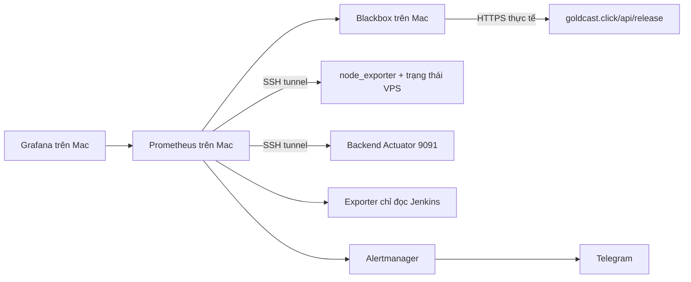

# Monitoring GoldCast

Monitoring chạy độc lập với các bước G1 → Build → G2 → Deploy → G3. Jenkins
kiểm bản phát hành; monitoring tiếp tục quan sát khi pipeline đã kết thúc.
Máy Mac chạy Jenkins đặt Prometheus, Grafana, Alertmanager và Blackbox; VPS
chỉ chạy node_exporter và bộ thu trạng thái mỗi phút.



## Phạm vi

| Lớp | Tín hiệu và điều kiện chính |
|---|---|
| Người dùng | HTTPS trả định danh hợp lệ; lỗi liên tục 2 phút; chứng chỉ còn dưới 14 ngày |
| VPS | CPU trên 90% trong 10 phút, RAM khả dụng dưới 10%, đĩa còn dưới 15% |
| Container | Running/health, restart, OOM; Caddy có kiểm HTTPS độc lập |
| Backend | Readiness gồm DB, JVM, pool kết nối, API 5xx trên 5%, p95 trên 2 giây khi đủ mẫu |
| Dữ liệu | Thiếu quan sát, chậm trên 2 ngày công bố, ngày tương lai, synthetic, ingest/provider ngừng cập nhật |
| Release | Hai image ID đúng digest trong last-good, định danh HTTPS khớp, khóa tồn tại quá 20 phút |
| CI/backup | Kết quả job `goldcast-ci`, `goldcast-backup`; backup thành công quá 30 giờ, job chạy quá lâu |
| Bộ giám sát | SSH mất, exporter lỗi, collector ngừng cập nhật; không coi cache cũ là healthy |

31 luật trong [alerts.yml](../monitoring/prometheus/alerts.yml). Luật `info`
chỉ hiện trên dashboard. Cảnh báo `warning`/`critical` gửi Telegram, có tin
phục hồi; gom nhóm theo site/alertname, lặp sau 6 giờ. Khi mất tunnel/collector,
Alertmanager chặn các cảnh báo phụ liên quan để giảm tin trùng. Sai phiên
bản/image được bỏ qua trong thời gian giữ khóa Deploy/G3/backup; khóa treo
vẫn có luật riêng. Job diễn tập cố ý thất bại không nằm trong danh sách theo dõi.

## Cổng, bí mật và lưu trữ

- Backend production phục vụ API ở 8080 trong mạng Docker, management 9091
  chỉ publish `127.0.0.1:9091`. node_exporter chỉ nghe `127.0.0.1:9100` trên VPS.
  Prometheus đi qua SSH với host key đã xác minh; không mở thêm cổng Internet.
- Trên Mac: Grafana `http://127.0.0.1:3001`, Prometheus `:9090`, Alertmanager
  `:9093`, đều bind loopback. Grafana bắt đăng nhập, không bật anonymous.
- Token Telegram, chat_id, token Jenkins và mật khẩu Grafana ở
  `~/.config/goldcast-monitoring/`, thư mục 700, file 600, ngoài Git.
  Xem mật khẩu Grafana trực tiếp từ file `grafana_admin_password` khi đăng nhập
  bằng tài khoản `admin`; không dán mật khẩu/token vào issue hoặc artifact.
- Exporter Jenkins chỉ gọi GET của hai job cho phép. Nên dùng tài khoản riêng
  có Overall/Read và Job/Read; cấu hình không thay quyền token hiện có.
  SSH key cần cho phép forwarding tới 127.0.0.1:9091/9100; ưu tiên key riêng
  chỉ được forward hai địa chỉ này khi tách quyền vận hành.
- Prometheus giữ tối đa 7 ngày và giới hạn TSDB 512 MB; Grafana/Alertmanager
  dùng named volume. Docker log xoay vòng 3 file × 10 MB/container.
  Cấu hình chạy được chụp ra `~/.local/share/goldcast-monitoring/releases/`,
  symlink `current` chỉ tới bản đã khởi động thành công; đổi nhánh Git không
  làm mất các bind mount đang dùng. Không chạy `down -v` để bảo trì thường ngày.

## Cài đặt và kiểm tra

Trên Mac, nhập bí mật bằng prompt ẩn; không đặt token trong dòng lệnh:

```sh
python3 monitoring/configure.py --ssh-key "$HOME/.ssh/jenkins_deploy"
sh monitoring/check.sh
```

Đưa thư mục `monitoring/` từ đúng commit đã kiểm tra lên
`/opt/goldcast/monitoring/` trên VPS, rồi chạy bằng user deploy:

```sh
sh /opt/goldcast/monitoring/vps/install.sh
```

Lệnh chỉ cài node_exporter và timer; không deploy/restart ứng dụng. Metrics
backend chỉ có sau khi image chứa registry Prometheus qua G2 và được triển
khai bằng pipeline. G2 kiểm metric families, release_id và management tách cổng
trong cả cài mới lẫn nâng cấp schema có dữ liệu.

```sh
python3 monitoring/start.py
curl -fsS http://127.0.0.1:9090/-/ready
curl -fsS http://127.0.0.1:9090/api/v1/targets
curl -fsS http://127.0.0.1:3001/api/health
```

Mở dashboard **GoldCast — Operations** (UID `goldcast-operations`). Xác nhận
các target UP, probe HTTPS/readiness thành công, tuổi collector dưới 180
giây, last-good/image/HTTPS khớp. Nếu đang chuyển đổi và backend chưa có
metrics, ghi rõ target còn thiếu; không báo hệ thống đã giám sát đầy đủ.

Kiểm thử đường cảnh báo có kiểm soát, không dừng production:

```sh
python3 monitoring/test-notification.py fire
# Chờ nhận FIRING trên Telegram, kiểm bộ đếm lỗi gửi = 0.
python3 monitoring/test-notification.py resolve
# Chờ nhận RESOLVED; /metrics của Alertmanager phải ghi nhận hai lần gửi.
```

CI chạy 5 kịch bản promtool: lỗi thoáng qua, lỗi kéo dài rồi phục hồi, backup
quá hạn, khóa deploy chặn sai phiên bản chuyển tiếp, provider tắt. Ngoài ra
có unit test Java cho lịch cuối tuần/mất DB/ngày tương lai và Python cho
Jenkins/VPS lỗi, sai digest, định danh và ghi textfile nguyên tử. Các phép
thử luật không gửi Telegram và không làm thay đổi production.

## Runbook

1. **Website/readiness đỏ:** thử HTTPS từ máy ngoài VPS, xem Jenkins Deploy/G3
   và `release.sh status`; đọc log/health backend, frontend, Caddy và DB.
   Dùng rollback/recover theo [tutorial](tutorial.md); không sửa con trỏ để che lỗi.
2. **Mất tunnel/metrics:** kiểm kết nối SSH, host key, key forwarding; trên VPS
   kiểm `systemctl status goldcast-monitoring.timer goldcast-monitoring.service`
   và `journalctl -u goldcast-monitoring.service`. Không mở 9091/9100 công khai.
3. **CPU/RAM/đĩa:** đối chiếu dashboard và `docker stats --no-stream`, `df -h`;
   kiểm log rotation/retention và workload. Không prune toàn bộ Docker hoặc xóa
   volume dữ liệu/backup để xử lý cảnh báo.
4. **Giá cũ/nguồn lỗi:** đối chiếu observedOn, lịch giao dịch và provider trong
   trạng thái ingest. Không bật seed synthetic để che feed hỏng. Cache metrics
   chỉ hợp lệ khi refresh thành công và timestamp mới; scrape không truy vấn DB.
5. **Sai release/image:** so last-good với `/api/release` và Docker image ID.
   Nếu khóa deploy còn tồn tại, kiểm owner/build trước; không xóa theo tuổi.
6. **Backup đỏ/quá hạn:** đọc đúng build của `goldcast-backup`, xác minh
   checksum/restore; giữ bản tốt trước đó. Không coi file dump tồn tại là đã restore được.
7. **Không thấy Telegram:** kiểm Alertmanager `/metrics`, lọc integration
   `telegram`, bộ đếm notification failed; kiểm bot/chat_id, route, silence và
   inhibition. Không công khai log chứa URL Telegram/token.

## Giới hạn cần trình bày trong đồ án

Mac phải bật, không sleep và Docker Desktop phải chạy. Khi Mac hoặc đường
Internet của Mac ngừng hoạt động, toàn bộ bộ giám sát cũng ngừng gửi; cần thêm
dead-man check ở máy/dịch vụ độc lập nếu yêu cầu phát hiện được cả trường hợp này.
Giữ 7 ngày phục vụ đồ án, không phải kho số liệu dài hạn hoặc HA. Dashboard
hiển thị metrics tổng hợp, chưa có log tập trung/tracing và chưa có SLO/error budget.

Lịch freshness mới bỏ cuối tuần cho spot/FX, chưa có ngày lễ. Telemetry ingest
reset sau restart, nên luật provider có khoảng chờ 3 giờ. Timestamp được giữ
đủ độ chính xác, không làm tròn mất hàng phút khi xuất metric. Synthetic là
nhãn nguồn của quan sát mới nhất, không khẳng định toàn bộ lịch sử là thật.
